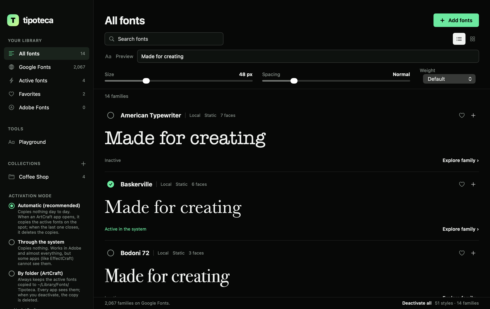
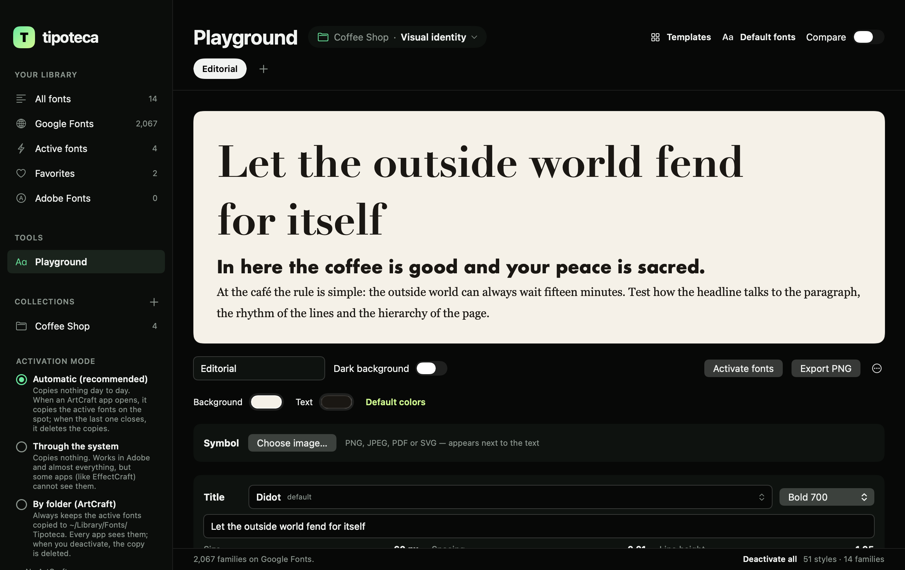

# Tipoteca

[Português](README.md) · **English**

A native macOS font manager (SwiftUI, no Electron). Keep your font library off the system disk (e.g. on an external
drive), preview fonts **without installing them**, and activate/deactivate by family or collection.




## Features
- Library in any folder, including external drives; "index without copying" or copy into the library
- Preview without installing; activate by family, collection or favorites (CoreText, nothing is copied to the system)
- Google Fonts (official download) and Adobe Fonts (read-only view of the local cache)
- Glyph map and variable-font axes
- Menu bar icon and panel with search and per-font toggles
- Launch at login
- Playground: compositions, per-client projects, ready-made templates, symbol, colors, PNG export
- English and Portuguese interface (follows the macOS language)
- Compatibility with apps that only read font folders (Automatic mode, below)

## Requirements
- macOS 14+, Apple Silicon
- Command Line Tools (`xcode-select --install`). Full Xcode is not required.

## Build and install
```bash
./build.sh              # builds ./Tipoteca.app
./build.sh --install    # also installs to ~/Applications
TIPOTECA_INSTALL_DIR="/other/folder" ./build.sh --install
```
The app is ad-hoc signed (no developer account, not notarized). On first launch macOS may warn: right-click the app >
**Open**, or run `xattr -cr Tipoteca.app`.

> On an exFAT volume macOS creates `._*` files that break the code signature, so `build.sh` builds in a temp folder
> and copies a clean app.

## Tests
```bash
./tests/run.sh          # checks translations and runs the Swift tests (never touches your library)
./tools/snapshot.sh     # regenerates the README images (docs/screenshots)
```
GitHub Actions runs the tests and builds the app on every change.

## Languages
English and Portuguese. The code uses the English text as the key; translations live in `Resources/<language>.lproj/Localizable.strings`.
To add a language, copy `Resources/pt.lproj` to `Resources/<code>.lproj`, translate the values and run `./tests/run.sh`.

## Data
`~/Library/Application Support/Tipoteca/` (`library.json`, `playground.json`, `backup/`, `font-cache/`).
The repository ships **no fonts and no user data**.

## Activation modes
| Mode | Behavior |
|---|---|
| **Automatic** (default) | Activates via the system; when an app that only reads font folders launches, creates hard links of active fonts in `~/Library/Fonts/Tipoteca` and removes them ~4 s after the last such app quits |
| **System** | CoreText (`CTFontManagerRegisterFontsForURLs`); nothing is copied |
| **Folder** | Keeps active fonts in `~/Library/Fonts/Tipoteca` at all times |

Automatic mode runs a process watcher (25 ms, ~1% CPU) only while that mode is selected. Do not use symlinks in
`~/Library/Fonts`: some apps hang on launch.

## Tested with
- Adobe (Photoshop, Illustrator) and CoreText-based apps: live activation
- [ArtCraft](https://getartcraft.com/) suite: DesignCraft, PhotoCraft and EffectCraft tested; others not yet
- TraceDraw: only reads font folders, and only once, when it opens. To be safe, use the **By folder (ArtCraft)** mode (Automatic can be too late)

## Font licenses
Tipoteca **does not redistribute fonts**. Each font has its own license: check it before commercial use.
Many fonts on free-download sites are "personal use only".

## Disclaimer
Tipoteca is an independent project. It is not affiliated with, sponsored or endorsed by Adobe, Google, ArtCraft
or DaFont; these names are used only to indicate compatibility or inspiration.

## Contributing
See [CONTRIBUTING.md](CONTRIBUTING.md). License: [MIT](LICENSE).
