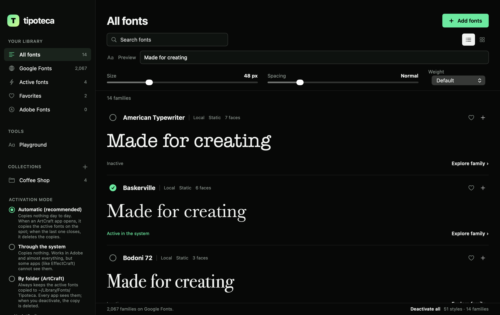
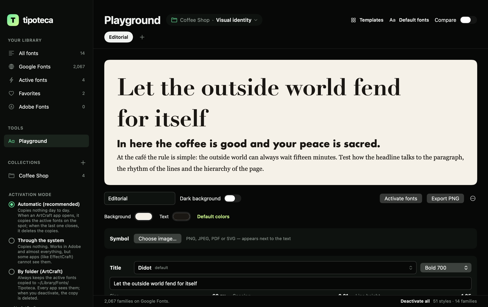

# Tipoteca

**Português** · [English](README.en.md)

Gerenciador de fontes nativo para macOS (SwiftUI, sem Electron). Mantém a biblioteca de fontes fora do disco do sistema
(por exemplo, num HD externo), mostra prévia **sem instalar** e ativa/desativa por família ou coleção.




## Recursos
- Biblioteca em qualquer pasta, inclusive HD externo; "indexar sem copiar" ou copiar para a biblioteca
- Prévia sem instalar; ativação por família, coleção ou favoritos (CoreText, nada é copiado para o sistema)
- Google Fonts (download oficial) e Adobe Fonts (somente leitura do cache local)
- Mapa de glifos e eixos de fontes variáveis
- Ícone e painel na barra de menus, com busca e check para ativar/desativar
- Abrir ao ligar o Mac
- Playground: composições, projetos por cliente, modelos prontos, símbolo, cores e exportação em PNG
- Interface em português e inglês (segue o idioma do macOS)
- Compatibilidade com apps que só leem pastas de fontes (modo Automático, veja abaixo)

## Requisitos
- macOS 14 ou superior, Apple Silicon
- Command Line Tools (`xcode-select --install`). O Xcode completo não é necessário.

## Compilar e instalar
```bash
./build.sh              # gera ./Tipoteca.app
./build.sh --install    # também instala em ~/Applications
TIPOTECA_INSTALL_DIR="/outra/pasta" ./build.sh --install
```
O app é assinado de forma *ad-hoc* (sem conta de desenvolvedor, sem notarização). Na primeira abertura o macOS pode
avisar: clique com o botão direito no app > **Abrir**, ou rode `xattr -cr Tipoteca.app`.

> Se o seu projeto estiver num volume exFAT, o macOS cria arquivos `._*` que invalidam a assinatura.
> Por isso o `build.sh` compila numa pasta temporária e copia o app limpo.

## Testes
```bash
./tests/run.sh          # confere as traduções e roda os testes em Swift (não toca na sua biblioteca)
./tools/snapshot.sh     # regenera as imagens do README (docs/screenshots)
```
O GitHub Actions roda os testes e compila o app a cada alteração.

## Idiomas
Português e inglês. O código usa o texto em inglês como chave e as traduções ficam em `Resources/<idioma>.lproj/Localizable.strings`.
Para adicionar um idioma, copie `Resources/pt.lproj` para `Resources/<código>.lproj`, traduza os valores e rode `./tests/run.sh`.

## Onde ficam os dados
`~/Library/Application Support/Tipoteca/` (`library.json`, `playground.json`, `backup/`, `font-cache/`).
O projeto **não** inclui fontes nem dados de usuários.

## Modos de ativação
| Modo | O que faz |
|---|---|
| **Automático** (padrão) | Ativa pelo sistema e, quando percebe um app que só lê pastas de fontes abrindo, cria *hard links* das fontes ativas em `~/Library/Fonts/Tipoteca`; remove ~4 s depois que o último fecha |
| **Pelo sistema** | CoreText (`CTFontManagerRegisterFontsForURLs`); nada é copiado |
| **Por pasta** | Mantém as fontes ativas em `~/Library/Fonts/Tipoteca` o tempo todo |

O modo Automático usa uma vigia de processos (25 ms, ~1% de CPU) que só roda nesse modo. Não use links simbólicos em
`~/Library/Fonts`: alguns apps travam ao abrir.

## Compatibilidade testada
- Adobe (Photoshop, Illustrator) e apps que usam CoreText: ativação em tempo real
- Suíte [ArtCraft](https://getartcraft.com/): DesignCraft, PhotoCraft e EffectCraft testados; os demais ainda não
- TraceDraw: só lê pastas de fontes e as lê uma vez, ao abrir. Para garantir, use o modo **Por pasta (ArtCraft)** (o Automático pode chegar tarde demais)

## Licença das fontes
O Tipoteca **não redistribui fontes**. Cada fonte tem a sua licença: confira antes de usar em trabalho comercial.
Muitas fontes de sites de download gratuito são "somente uso pessoal".

## Aviso
Tipoteca é um projeto independente. Não é afiliado, patrocinado nem endossado por Adobe, Google, ArtCraft ou
DaFont; esses nomes são citados apenas para indicar compatibilidade ou inspiração.

## Contribuir
Veja [CONTRIBUTING.md](CONTRIBUTING.md). Licença: [MIT](LICENSE).
